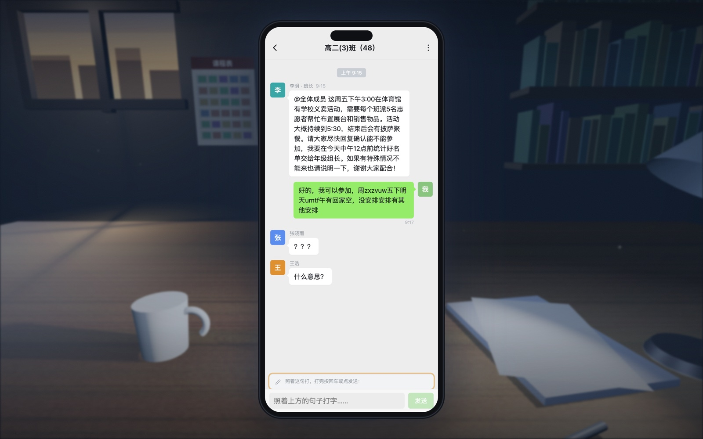
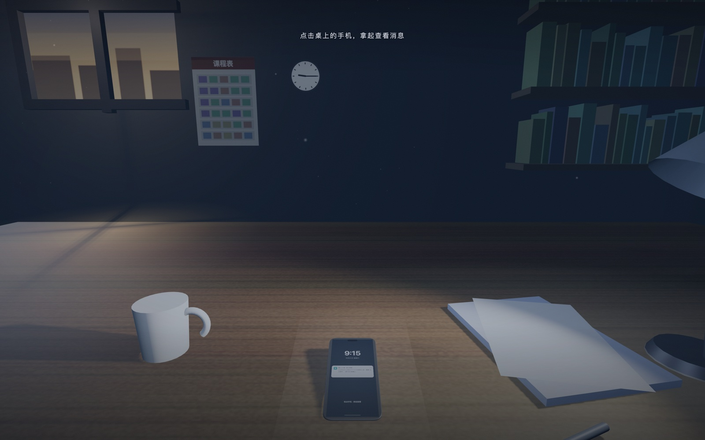
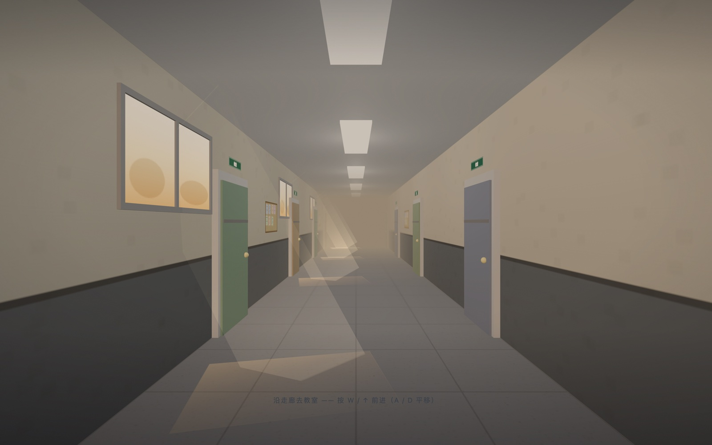
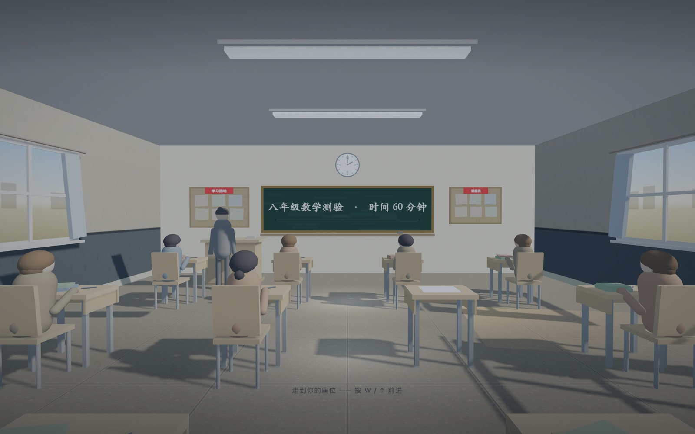
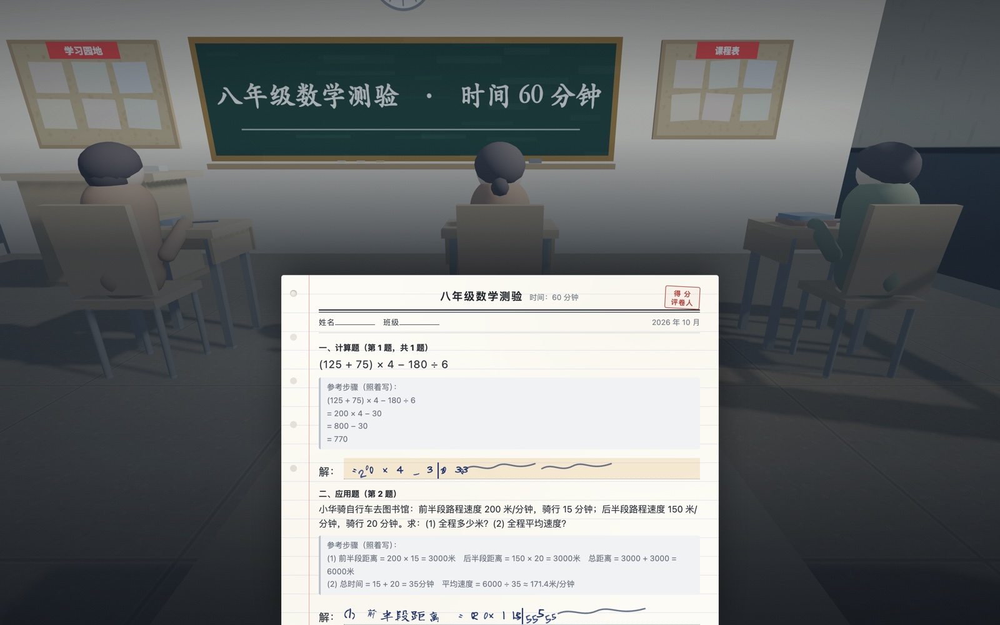
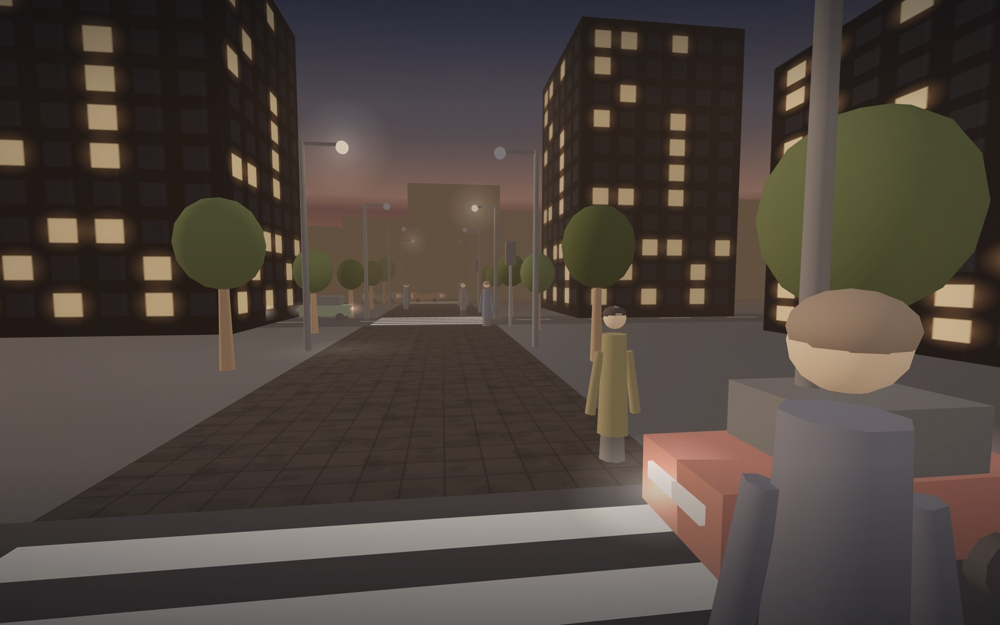

# Narcolepsy · One Ordinary Day

[](README.md)
[](README.zh-CN.md)

A first-person interactive piece about one ordinary school day with narcolepsy — a class group chat, a maths exam, and the walk home. You type, you write, you cross the road. Then you are simply asleep.

Official Link: [https://rockeyld.github.io/One-Ordinary-Day/](https://rockeyld.github.io/One-Ordinary-Day/)



<details>
<summary>More screenshots</summary>







</details>

---

## Developer Notes for AI Assistants and Modders

### 1. Project Architecture
- **Single-file app**: Everything lives in `index.html` (embedded CSS + JavaScript + inline SVG). No build step, no frameworks, no bundler.
- **3D dependency**: Three.js `0.149.0` from jsDelivr (`<script src>` in `<head>`). This is the only external request the page makes — everything else (logo PNG, textures, icons) is inline `data:` / `<template>`.
- **No assets folder for logic**: `Image/` holds README screenshots only. The page never loads from it.
- **Renderer**: one shared `WebGLRenderer` (`initThree()`), `antialias`, `setPixelRatio(min(dpr, 2))`, `outputEncoding = sRGBEncoding`, `toneMapping = ACESFilmicToneMapping`.
- **Render loop**: a single `requestAnimationFrame` loop reads the current `world` object and calls `world.update(dt)` then renders `world.scene / world.cam`. `startWorld(w)` hot-swaps worlds.

### 2. Scene Flow & State Machine
The story is a linear chain of `world` objects plus DOM layers. There is no router; each act hands off by calling the next function.

| # | Act | Presentation | Entry function |
|---|-----|--------------|----------------|
| 0 | Studio intro | DOM sprite stage (`#studioIntro`) | self-running IIFE, gated by `SI_SKIP` |
| 0 | Title card | DOM overlay `#intro` | `skipIntro()` |
| 1 | Class group chat | 3D desk → large **DOM** phone | `makeDeskWorld()` / `startDeskWorld()` |
| 2 | Corridor | 3D, WASD walk | `makeCorridorWorld()` / `startCorridor()` |
| 3 | Classroom + exam | 3D room + DOM paper `#paperWrap` | `makeClassroomWorld()` / `startClassroom()` |
| 3 | Pack bag | DOM card `#packOverlay` | `#bagBtn` click → `whisper()` |
| 4 | Street | 3D, three crossings | `makeStreetWorld()` / `startStreetWorld()` |
| 5 | Freeze → data → credits | DOM `#wordSeq` / `#dataSeq` / `#finalCard` | `streetFreeze()` |

- **Act 1 hand-off**: the 3D phone lies on the desk; a click/raycast lifts it (`world.picked`), the canvas fades out, and the big 2D `.phone` fades in. Typing happens in a real DOM input, never on a canvas texture.
- **Act 3 hand-off**: the paper is DOM (`.paper` with `#q1` / `#q2` and `#ans1` / `#ans2`), so answers are editable text, not drawn glyphs. The classroom only supplies background + teacher patrol.
- **World object contract**: `{ scene, cam, update(dt), gradeId?, ... }`. Anything returning from `make*World()` must supply `update`; `startWorld` applies `gradeId` automatically.

### 3. The Garble Engine (why the wrong text looks wrong that way)
Act 1 and Act 3 produce garbled output on purpose. The gibberish is generated by documented error families, **not** uniform random noise — see `makeGib()` / `swapOrder()` around line 900.

- **① Perseveration** — rewriting characters that were just produced (`≈40%` of drops). Tail of the current input repeated 2–5 times.
- **② Item intrusion** — task-irrelevant words injected mid-string (`INTRUDE` list, e.g. `回家 / 睡觉 / 作业`), sometimes followed by noise.
- **③ Sequencing error** — two adjacent characters swapped. Only arms after the second episode (`totalMicro >= 2`).
- **④ Key-string** — fluent, meaningless runs of *keyboard-adjacent* letters (`KEYROW` = QWERTY rows), used when there are no CJK characters to corrupt.
- **Degradation**: `totalMicro` counts episodes and widens every family — the third answer breaks harder than the first. This is deliberate; do not "balance" it.

### 4. The Blackout Scheduler
```js
blackout(dur, { long = false, onWake = null } = {})
```
- Screen goes **fully black with no text**. Earlier builds printed a caption ("这几秒你不在"); that was removed on request and the `cap` argument is now dead — do not reintroduce it.
- `blacking` is a global mutex. **If a blackout is already running, `blackout()` returns immediately and `onWake` is silently dropped.** Any caller that must continue afterwards has to retry (see `tickLong`, which polls every 700 ms) — this exact bug used to hard-lock the exam.
- `long: true` marks the narcoleptic episodes that arm a 14 s timer (`armLong` / `tickLong`) so the episode lands even if the player stops typing.

### 5. Text Input & IME
- Two invisible capture inputs exist: `#ansInput` (question 1) and `#ansInput2` (question 2). Both must keep `opacity:0` in CSS — a missing rule once left a bare white box floating on the exam paper.
- IME safety is threefold: `compositionstart` / `compositionend` tracking, reset on `blur`, and a 350 ms watchdog sweep that clears a stuck `composing` flag.
- `send()` sets a `busy` flag; `startPhase()` force-resets it. A `busy` flag that never cleared is what once made the blackout fire only once per session.
- The capture input lives **inside the viewport** (not at `-9999px`) so mobile browsers do not auto-scroll the layout when focusing.

### 6. The 3D Worlds
- **Desk** — dawn window light, floating dust (`Points`), a spotlight lamp, beveled phone via `ExtrudeGeometry`, screen material `toneMapped:false` so the UI is not crushed by ACES.
- **Corridor** — left-wall windows casting additive light shafts onto the floor, door frames offset in front of door leaves (an earlier build had the frame geometry *covering* every door), cork boards and plants to fill bare wall.
- **Classroom** — seated student models, sun `DirectionalLight` with a 1024 shadow map; only non-floor meshes cast shadows, otherwise walls slice the sun and produce bright wedges.
- **Street** — gradient sky dome (`BackSide`, `fog:false`), darker asphalt, lamp glow sprites that switch on as the freeze darkens the scene, distant building silhouettes to hold the sky down.

### 7. Colour Grade Layer
`#grade` sits **above the 3D canvas and below every UI layer**, and applies three stacked effects from CSS custom properties: `--tint` (veil), `--vig` (vignette + top/bottom falloff), `--grainOp` (SVG `feTurbulence` film grain, jittered in 5 steps).

```js
const GRADES = {
  desk:      { tint:'rgba(26,46,78,.36)',  vig:.95, grain:.062 },  // dawn: cold blue
  corridor:  { tint:'rgba(122,88,46,.26)', vig:.70, grain:.048 },  // afternoon: warm grey
  classroom: { tint:'rgba(36,56,78,.28)',  vig:.78, grain:.050 },  // exam: neutral-cool
  street:    { tint:'rgba(122,74,44,.19)', vig:.92, grain:.070 },  // dusk: amber
  night:     { tint:'rgba(18,30,56,.40)',  vig:1.0, grain:.085 },  // post-freeze
};
```
`setGrade(key)` writes the three variables; `startWorld()` applies `world.gradeId`; the street switches itself to `'night'` once the darkening passes 25 % (`st.gradeNight`). Keep the dark end of every scene blue-shifted and the highlights warm — that contrast is the whole look.

### 8. Audio
`SFX` is a small WebAudio synth (no files): `hum`, `key`, `tick`, `step`, `chair`, `brake`, `horn`, `murmur`, plus a noise buffer. Everything is gated behind `SFX.ensure()` on the first user gesture, because browsers block audio before one.

### 9. Studio Intro
`#studioIntro` replays the Dragon Studio opening as a DOM sprite system (`Sprite` + `COS` costumes rendered as inline SVG, `data:` PNG for the dragon mark).
- Easing maths (`bounceOut`, `elasticOut`) are copied frame-for-frame from the original project.
- **`collapseOut` exists for exits only.** `elasticOut` overshoots past 1; using it to shrink 100 → 0 makes `size` negative, and a negative CSS `scale()` mirrors the logo. `Sprite.apply()` also clamps with `Math.max(0, size/100)` as a hard backstop.
- The stage has no background and no shadow — the greyscale logo floats directly on the dark page.
- Skippable: any click, or `?skip=1`, or `AUTO`/`RM` (reduced-motion) at boot.

### 10. Debug Hooks
Append to the URL. Useful for screenshots and regressions.

| Flag | Effect |
|------|--------|
| `?skip=1` | Skip the studio intro |
| `?shot=desk\|sent\|corridor\|classroom\|exam\|messy\|street` | Jump straight to one moment |
| `?still=1` | Single frame, all transitions off (pairs with `?shot`) |
| `?fast=1` | Compress every `D(ms)` wait |
| `?autotest=1` | Walk the whole story headlessly, set `document.title = AUTOTEST_OK` |
| `?noshadow=1` | Disable shadow maps (perf check) |
| `?top=1` | Top-down camera |

### 11. Common Pitfalls
- **Negative scale**: never shrink a sprite with `elasticOut`. See §9.
- **Dropped `onWake`**: `blackout()` is not re-entrant; queue and retry instead of assuming the callback ran.
- **Movement relative to the camera**: classroom walking uses `cam.getWorldDirection()` projected onto XZ. Hard-coding `-z` makes controls invert the moment the camera turns toward the door.
- **Input focus**: a hidden capture input placed outside the viewport breaks focus on some mobile browsers — keep it in-flow.
- **Door/z-fighting**: door frames must sit *behind* the leaf (smaller |x|), or the frame covers the door entirely.
- **Shadow acne on walls**: restrict `castShadow` to furniture and characters; let the floor and walls only `receiveShadow`.
- **New files under `Image/`**: must be `git add`ed and pushed, or the README images 404 on Pages.
