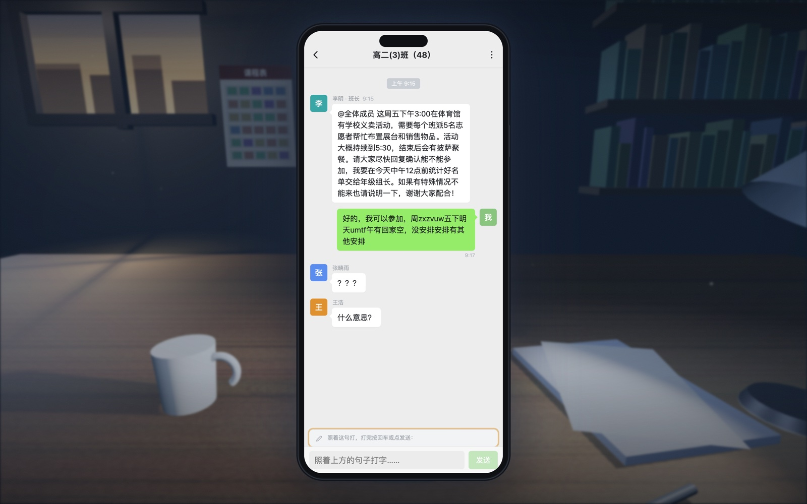
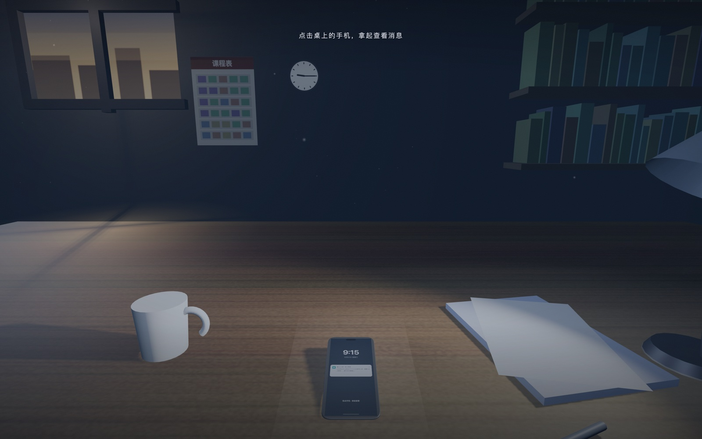
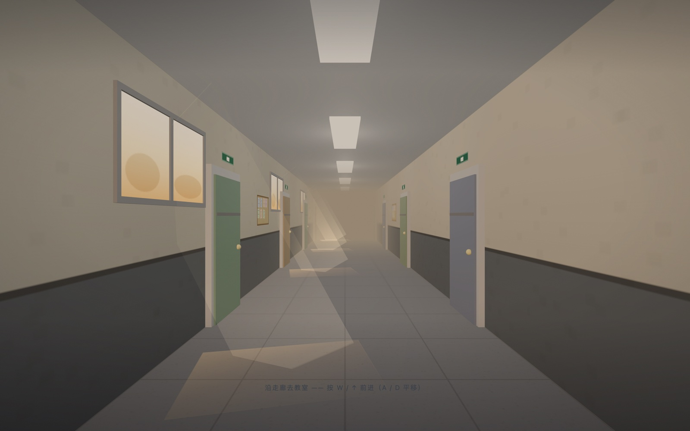
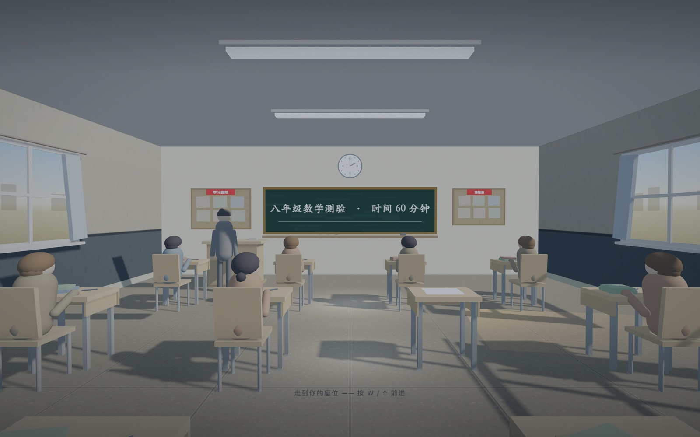
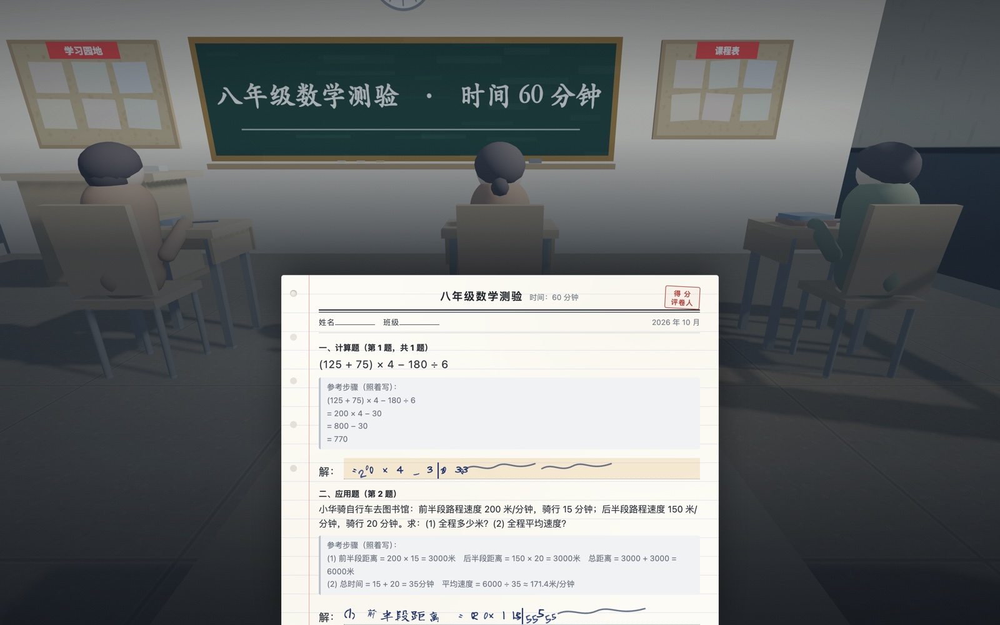
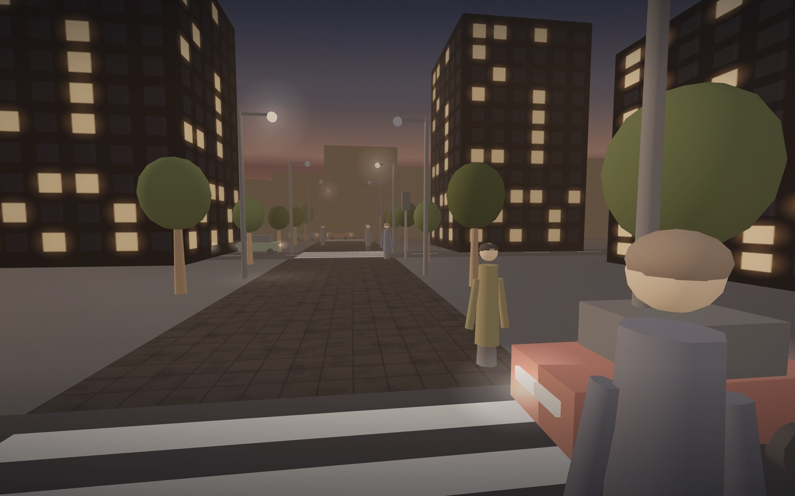

# 发作性睡病 · 一次普通的一天

[](README.md)
[](README.zh-CN.md)

一件第一人称的交互作品，记录发作性睡病患者的普通一天——班级群里的回复、一场数学考试、放学后过马路。你打字、写字、走路。然后你就睡着了。

正式链接：[https://rockeyld.github.io/One-Ordinary-Day/](https://rockeyld.github.io/One-Ordinary-Day/)



<details>
<summary>更多截图</summary>







</details>

---

## 开发者说明（给 AI 助手与二次修改者）

### 1. 项目结构
- **单文件应用**：全部内容在 `index.html`（内联 CSS + JavaScript + 内联 SVG）。没有构建步骤、没有框架、没有打包器。
- **唯一的 3D 依赖**：Three.js `0.149.0`，从 jsDelivr 以 `<script src>` 引入。这是页面唯一的外部请求，其余资源（logo PNG、贴图、图标）全部内联为 `data:` 或 `<template>`。
- **`Image/` 只放 README 截图**，运行时不从这里加载任何东西。
- **渲染器**：全局单例（`initThree()`），`antialias`、`setPixelRatio(min(dpr, 2))`、`outputEncoding = sRGBEncoding`、`toneMapping = ACESFilmicToneMapping`。
- **渲染循环**：单个 `requestAnimationFrame` 循环读取当前 `world`，调用 `world.update(dt)` 后渲染 `world.scene / world.cam`。`startWorld(w)` 负责热切换场景。

### 2. 场景流程与状态机
故事是一条线性链：`world` 对象 + DOM 图层。没有路由，每一幕靠直接调用下一幕的函数交棒。

| # | 幕 | 呈现方式 | 入口函数 |
|---|----|----------|----------|
| 0 | 片头 | DOM 精灵舞台 `#studioIntro` | 自执行 IIFE，`SI_SKIP` 控制是否跳过 |
| 0 | 开场卡 | DOM 覆盖层 `#intro` | `skipIntro()` |
| 1 | 班级群聊天 | 3D 桌面 → 大号 **DOM** 手机 | `makeDeskWorld()` / `startDeskWorld()` |
| 2 | 走廊 | 3D，WASD 行走 | `makeCorridorWorld()` / `startCorridor()` |
| 3 | 教室 + 考试 | 3D 房间 + DOM 试卷 `#paperWrap` | `makeClassroomWorld()` / `startClassroom()` |
| 3 | 收拾书包 | DOM 卡片 `#packOverlay` | 点击 `#bagBtn` → `whisper()` |
| 4 | 街道 | 3D，三个路口 | `makeStreetWorld()` / `startStreetWorld()` |
| 5 | 定格 → 数据 → 感谢卡 | DOM `#wordSeq` / `#dataSeq` / `#finalCard` | `streetFreeze()` |

- **第一幕交棒**：3D 里手机躺在桌上，点击（射线拾取）后拿起（`world.picked`），canvas 淡出、大号 2D `.phone` 淡入。打字发生在真实的 DOM input 上，永远不是画在 canvas 贴图上的假光标。
- **第三幕交棒**：试卷是 DOM（`.paper` + `#q1`/`#q2` + `#ans1`/`#ans2`），答案是可编辑文本而不是画出来的字。3D 教室只负责背景与老师巡视。
- **world 契约**：`{ scene, cam, update(dt), gradeId?, ... }`。`make*World()` 的返回值必须带 `update`；`startWorld` 会自动套用 `gradeId`。

### 3. 乱码引擎（为什么"错"得这么有规律）
第一幕与第三幕的破碎文字是故意生成的，但**不是均匀随机噪音**，而是按文献中的错误家族生成——见 `makeGib()` / `swapOrder()`（约第 900 行）。

- **① 重复（perseveration）**：把刚写过的字再写一遍（约占 40%）。取当前输入末尾 1–2 字，重复 2–5 遍。
- **② 插入（item intrusion）**：句子中间混入与任务无关的词（`INTRUDE`，如 `回家 / 睡觉 / 作业`），有时后面还跟着噪音。
- **③ 语序错乱（sequencing error）**：对调相邻两个汉字。只在第二次发作后才启用（`totalMicro >= 2`）。
- **④ 键串族**：流畅但无意义的**键盘相邻键**序列（`KEYROW` 为 QWERTY 三行），用于没有汉字可破坏的时候。
- **退化**：`totalMicro` 累计发作次数，会同时放大上述每一族——所以第三个答案比第一个碎得更厉害。这是设计，请不要"平衡"它。

### 4. 黑屏调度
```js
blackout(dur, { long = false, onWake = null } = {})
```
- 屏幕**全黑、一个字都没有**。早期版本会打一行"这几秒你不在"，已按需求删除，`cap` 参数现在是死参数，不要再加回来。
- `blacking` 是全局互斥量。**已有黑屏在跑时，`blackout()` 会直接 return，`onWake` 被静默丢掉。** 任何必须继续的调用方都要自己重试（参见 `tickLong`，每 700ms 轮询一次）——这个 bug 曾把考试流程永久卡死。
- `long: true` 标记真正的大发作，会启动 14 秒定时器（`armLong` / `tickLong`），保证玩家停止打字后发作也一定会发生。

### 5. 文本输入与输入法
- 有两个不可见的捕获 input：`#ansInput`（第 1 题）、`#ansInput2`（第 2 题）。两者在 CSS 里都必须保持 `opacity:0`——曾经漏了一条规则，导致试卷上裸着一个白框。
- 输入法三重防护：`compositionstart` / `compositionend` 跟踪、`blur` 时强制复位、350ms 巡检清除卡死的 `composing` 标记。
- `send()` 会置 `busy`，`startPhase()` 强制复位它。`busy` 永不复位曾导致"黑屏只来一次"。
- 捕获 input 放在**视口内部**（不是 `-9999px`），否则部分移动浏览器聚焦时会自动滚动整个版式。

### 6. 四个 3D 场景
- **桌面**：清晨窗光、浮尘（`Points`）、台灯聚光、`ExtrudeGeometry` 倒角手机，屏幕材质 `toneMapped:false`，避免 UI 被 ACES 压暗。
- **走廊**：左墙高窗在地面投加法光柱；门套几何必须比门板更靠里（早期版本门套**盖住**了所有门）；软木公告栏与绿植填补空墙。
- **教室**：坐姿学生模型、`DirectionalLight` 1024 阴影贴图；只有非地面网格投 `castShadow`，否则墙会切开太阳、出现亮楔形。
- **街道**：渐变天穹（`BackSide`，`fog:false`）、压暗的湿沥青、随定格变暗点亮的灯晕 Sprite、用远处楼群剪影把天空"按住"。

### 7. 全局调色层
`#grade` 位于 **3D canvas 之上、所有 UI 之下**，用三个 CSS 自定义属性叠三层效果：`--tint`（色调 veil）、`--vig`（暗角 + 上下压边）、`--grainOp`（SVG `feTurbulence` 胶片颗粒，5 帧抖动）。

```js
const GRADES = {
  desk:      { tint:'rgba(26,46,78,.36)',  vig:.95, grain:.062 },  // 清晨：冷蓝压底
  corridor:  { tint:'rgba(122,88,46,.26)', vig:.70, grain:.048 },  // 午后：暖灰
  classroom: { tint:'rgba(36,56,78,.28)',  vig:.78, grain:.050 },  // 考场：中性偏冷
  street:    { tint:'rgba(122,74,44,.19)', vig:.92, grain:.070 },  // 黄昏：琥珀
  night:     { tint:'rgba(18,30,56,.40)',  vig:1.0, grain:.085 },  // 定格之后
};
```
`setGrade(key)` 写入这三个变量；`startWorld()` 应用 `world.gradeId`；街道在天色变暗超过 25% 时自动切到 `'night'`（`st.gradeNight`）。请保持"暗部偏蓝、亮部偏暖"——整个质感就靠这个对比。

### 8. 音频
`SFX` 是一个小的 WebAudio 合成器（不用音频文件）：`hum`、`key`、`tick`、`step`、`chair`、`brake`、`horn`、`murmur`，外加一段噪声缓冲。全部经由第一次用户手势里的 `SFX.ensure()` 解锁——浏览器在此之前会拦掉音频。

### 9. 片头
`#studioIntro` 用 DOM 精灵系统重放 Dragon Studio 开场（`Sprite` + `COS` 造型，内联 SVG，龙形用 `data:` PNG）。
- 缓动数学（`bounceOut`、`elasticOut`）与原工程逐帧一致。
- **`collapseOut` 只用于退场。** `elasticOut` 的进度会冲过 1，拿它做 100 → 0 的缩小会让 `size` 变负，而负的 CSS `scale()` 会把 logo 镜像翻面。`Sprite.apply()` 里另有 `Math.max(0, size/100)` 作为硬兜底。
- 舞台没有背景也没有阴影，灰度 logo 直接浮在深色页面上。
- 可跳过：任意点击、`?skip=1`，或启动时的 `AUTO` / `RM`（减少动效偏好）。

### 10. 调试参数
拼在 URL 后面，截图与回归都用得上。

| 参数 | 作用 |
|------|------|
| `?skip=1` | 跳过片头 |
| `?shot=desk\|sent\|corridor\|classroom\|exam\|messy\|street` | 直接跳到某一刻 |
| `?still=1` | 只渲染一帧，关闭所有过渡（配合 `?shot`） |
| `?fast=1` | 压缩所有 `D(ms)` 等待 |
| `?autotest=1` | 无头跑完整条流程，把 `document.title` 置为 `AUTOTEST_OK` |
| `?noshadow=1` | 关阴影贴图（性能排查） |
| `?top=1` | 俯视机位 |

### 11. 常见坑
- **负缩放**：永远不要用 `elasticOut` 做缩小，见第 9 节。
- **`onWake` 丢失**：`blackout()` 不可重入，要排队重试，不要假设回调一定执行。
- **相对镜头移动**：教室行走用 `cam.getWorldDirection()` 投影到 XZ。硬写 `-z` 会让镜头转向门口后方向反过来。
- **输入焦点**：捕获 input 放到视口外会让部分移动浏览器聚焦失效，保持它在流内。
- **门与 z-fighting**：门套必须比门板更靠里（|x| 更小），否则整块盖住门。
- **墙面阴影脏**：`castShadow` 只给家具与人物，地面与墙只 `receiveShadow`。
- **`Image/` 新文件**：必须 `git add` 并推送，否则 README 图片在 Pages 上会 404。
